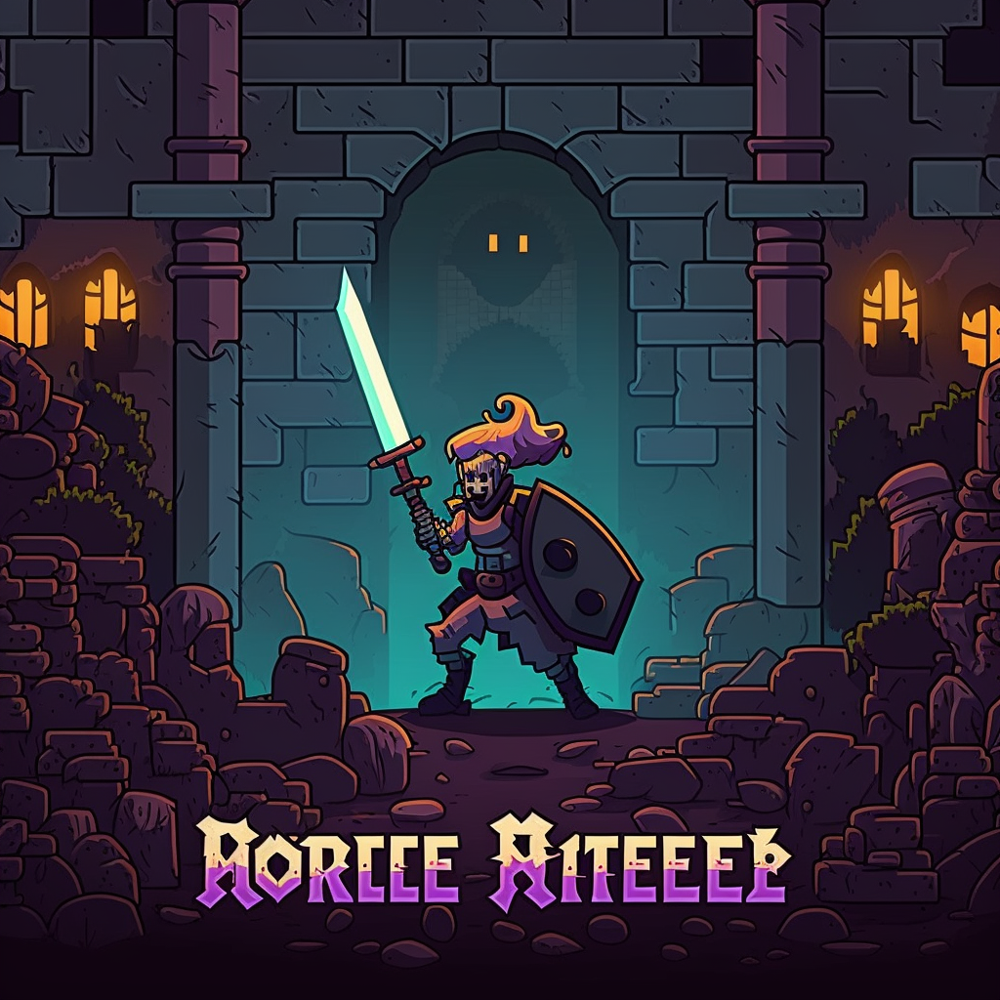
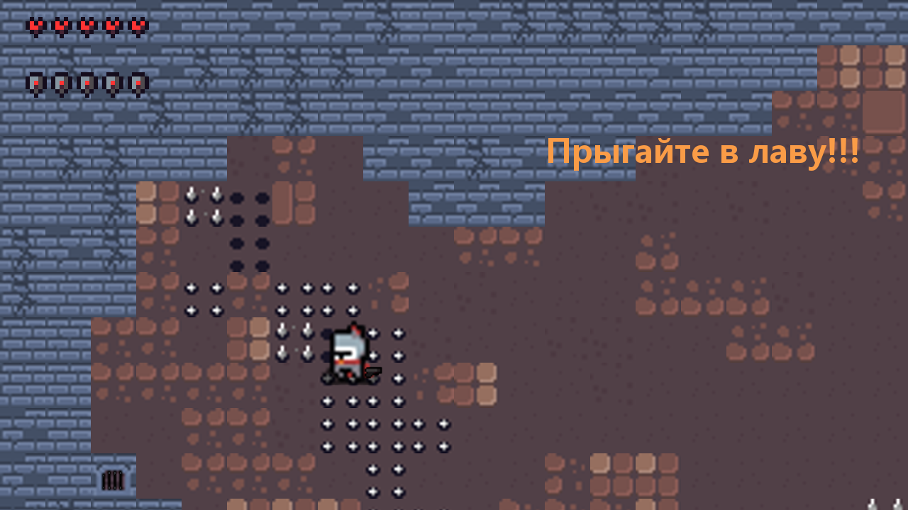
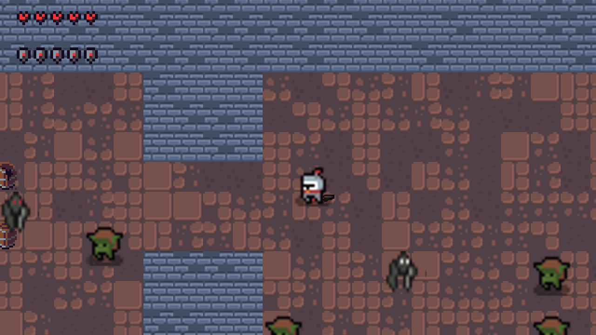

# Soul Knight

Небольшая игра в жанре dungeon crawler на Python и Pygame. Игрок управляет рыцарем, исследует случайно генерируемое подземелье и сражается с врагами с помощью огнестрельного оружия.



## Как выглядит игра

| Стартовая комната | Сгенерированное подземелье |
| --- | --- |
|  |  |

Кадры сделаны из запущенного игрового кода. Планировка подземелья и расположение противников меняются при генерации.

## Возможности

- Генерация комнат и коридоров подземелья.
- Разные противники, которые двигаются к игроку и атакуют его.
- Прицеливание мышью и стрельба; из побеждённых врагов может выпасть другое оружие.
- Полоски здоровья и защиты; защита постепенно восстанавливается после получения урона.
- Анимации, музыка и звуковые эффекты.

## Установка и запуск

Нужны Python, графический рабочий стол и аудиоустройство. Игровые сцены ветки `YandexLiceym` проверены в тестовом режиме SDL на macOS с Python 3.13, Pygame 2.6.1, NumPy 2.5.4, Pillow 13.0.0, screeninfo 0.8.1 и PyTMX 3.32. На других системах и версиях Python совместимость не проверялась.

1. Склонируйте репозиторий и перейдите в его корень:

   ```bash
   git clone --branch YandexLiceym https://github.com/ZakharovDmitry1/Soul_Knight.git
   cd Soul_Knight
   ```

2. Создайте и активируйте виртуальное окружение:

   ```bash
   python3 -m venv .venv
   source .venv/bin/activate
   ```

   В Windows вместо второй команды используйте `.venv\Scripts\activate` в командной строке или `.venv\Scripts\Activate.ps1` в PowerShell.

3. Установите библиотеки:

   ```bash
   python -m pip install pygame numpy Pillow screeninfo pytmx
   ```

4. Запустите игру **из корня репозитория** — пути к изображениям, музыке и картам относительные:

   ```bash
   python main.py
   ```

В репозитории есть `requirements.txt`, но сейчас он записан в формате таблицы `pip list`, а не в формате файла требований, и не включает PyTMX. Поэтому `pip install -r requirements.txt` не работает; используйте команду выше.

## Управление

| Действие | Клавиши |
| --- | --- |
| Движение | `W`, `A`, `S`, `D` или стрелки |
| Прицеливание | Движение мыши |
| Выстрел | Левая кнопка мыши |
| Подобрать выпавшее оружие | Нажать левой кнопкой мыши по оружию рядом с персонажем |
| Завершить текущую сцену | `Esc` или закрытие окна |
| Свернуть окно | `Q` |

## Особенности текущей версии

- При обычном запуске `main.py` последовательно вызывает стартовую комнату, сгенерированное подземелье и снова стартовую комнату. Класс босса и отдельная сцена присутствуют в коде, но в эту последовательность не включены.
- `Esc` и закрытие окна завершают текущую сцену, после чего может открыться следующая. Если требуется прервать программу сразу, можно остановить её в терминале сочетанием `Ctrl+C`.
- При генерации игра перезаписывает файлы в `maps/` и `cache/`, включая отслеживаемые Git файлы. Запускайте её из доступной для записи копии проекта; после запуска `git status` может показать изменения.
- В консоль выводятся отладочные сообщения, в том числе координаты противников.
- Окно создаётся по размеру первого обнаруженного монитора. Для запуска требуется доступ к дисплею; инициализация звука происходит при загрузке игры.

## Структура проекта

| Путь | Назначение |
| --- | --- |
| `main.py`, `main_windows/` | Последовательность игровых сцен, обработка ввода и игровые циклы |
| `generation_map.py` | Генерация карты, комнат, коридоров и маршрутов врагов |
| `start_map.py`, `boss_map.py` | Загрузка фиксированных карт из CSV |
| `player.py`, `anim.py`, `golem.py` | Игрок, противники и босс |
| `weapons.py`, `guns.py`, `short_guns.py`, `bullets.py` | Оружие и снаряды |
| `camera.py`, `healthbar.py`, `settings.py` | Камера, интерфейс и настройки |
| `maps/`, `cache/` | Карты и создаваемые во время игры изображения |
| `music/`, `sprites/`, папки наборов графики | Музыка, звуки и графические ресурсы |

## Графические ресурсы

В проекте используются несколько наборов спрайтов. В частности, в `v1.1 dungeon crawler 16X16 pixel pack/README.txt` указан автор [o_lobster](https://o-lobster.itch.io/). Условия использования отдельных ресурсов проверяйте в соответствующих наборах; общей лицензии проекта в репозитории не указано.
